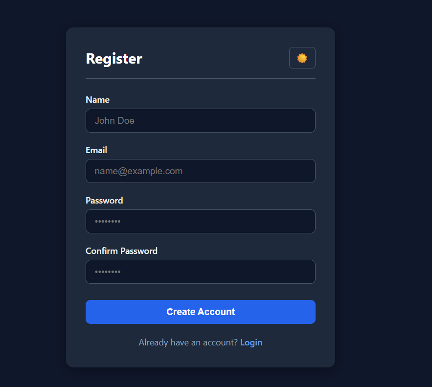
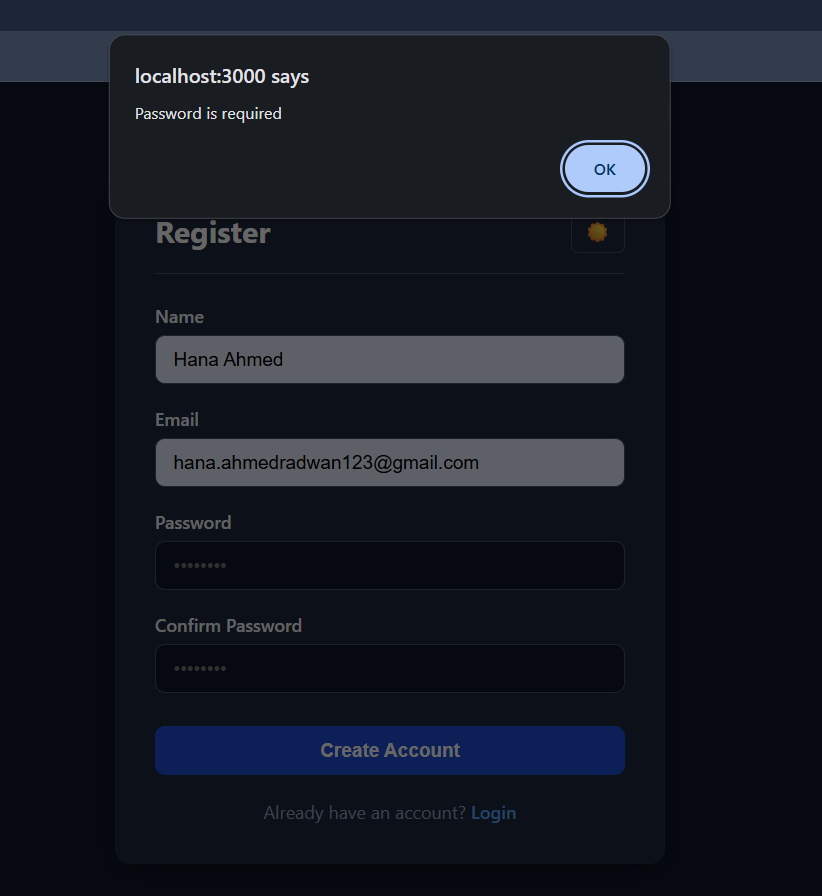
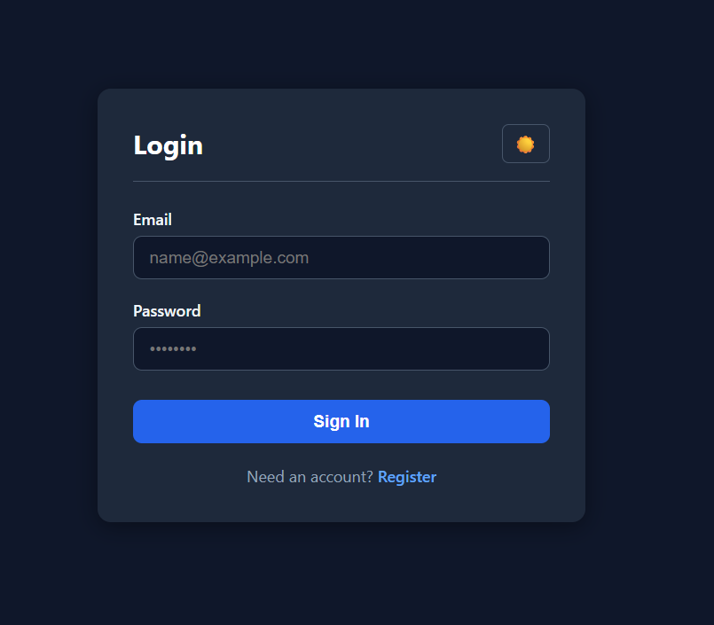
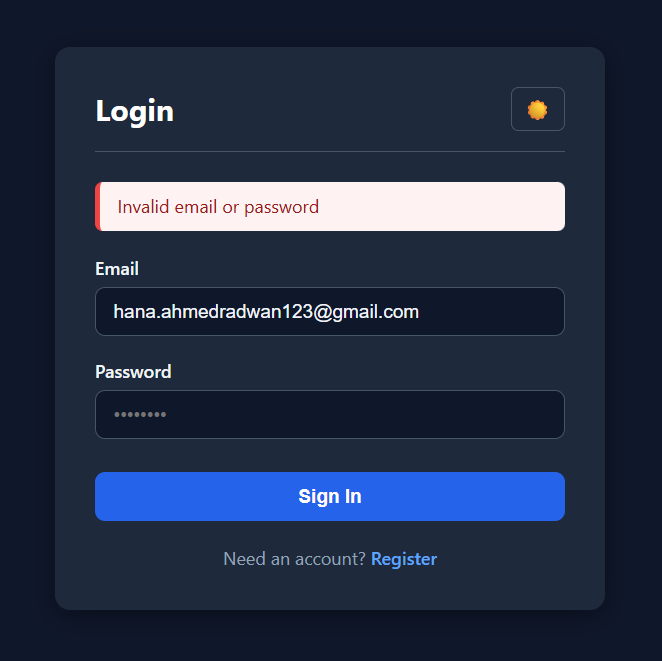

# Database Lab 2: Login & To-Do Application

## Team Information
- **Student Name**: Hana Ahmed Shehata
- **Student ID**: 2304081
- **Contribution**: Implemented MySQL database schema, Express backend, session handling, bcrypt authentication, parameterized SQL queries, and EJS frontend views.

---

## Technologies Used
- **Backend**: Node.js, Express.js
- **Database**: MySQL
- **Frontend**: EJS Templating, CSS
- **Authentication & Security**: `bcrypt` (password hashing), `express-session` (cookie sessions), Parameterized SQL queries (SQL injection prevention)

---

## How to Run

1. **Database Setup**:
   Import and run `database/schema.sql` inside MySQL Workbench or MySQL CLI:
   ```sql
   SOURCE database/schema.sql;
   ```

2. **Environment Configuration**:
   Copy `.env.example` to `.env` and fill in your MySQL credentials:
   ```bash
   cp .env.example .env
   ```

3. **Install Dependencies & Start**:
   ```bash
   npm install
   npm start
   ```
   Open `http://localhost:3000` in your browser.

---

## Features Implemented
- **R1 & R2**: Registration & Login with validation and unified error messages.
- **R3**: Session protection for private routes.
- **R4 - R7**: Full To-Do CRUD (Add, Edit, Toggle Done/Undone, Delete).
- **R8**: Client-side and server-side validation.
- **R9**: Bcrypt password hashing & parameterized SQL queries.
- **R10**: Responsive UI for desktop and mobile screens.

---

## Screenshots

### 1. Register Page


### 2. Validation Error Handling


### 3. Login Page


### 4. Login Invalid Credentials Error


### 5. To-Do List Dashboard


---

## Questions & Answers

**(a) Why do UPDATE and DELETE contain `AND user_id = ?` and what changes if you remove it?**
> Adding `AND user_id = ?` ensures row-level authorization. Without it, any authenticated user could modify or delete tasks owned by another user simply by altering the `todo_id` parameter in their request payload.

**(b) What happens if you insert a to-do for a `user_id` that does not exist, and which constraint of the lecture is that?**
> MySQL rejects the query with a foreign key violation error. This enforces the **Referential Integrity Constraint**.

**(c) Why do you store a hash and not the password?**
> Hashing prevents raw credentials from being exposed if the database is leaked. Algorithms like `bcrypt` add unique salts and deliberate computational delays to defend against rainbow table and brute-force attacks.

**(d) The `name` column is NOT NULL: why did you still need your own check for an empty name?**
> `NOT NULL` prevents `NULL` database values, but SQL still considers empty strings (`""`) or whitespace valid non-null values. Application-level checks trim inputs to ensure actual readable text is provided.